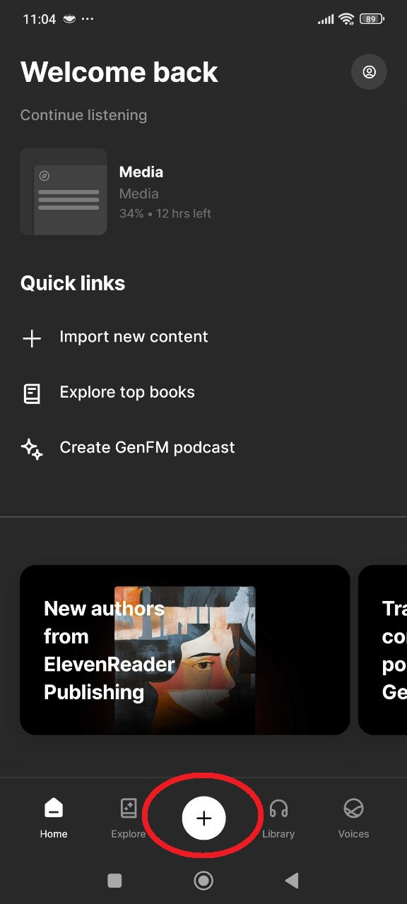
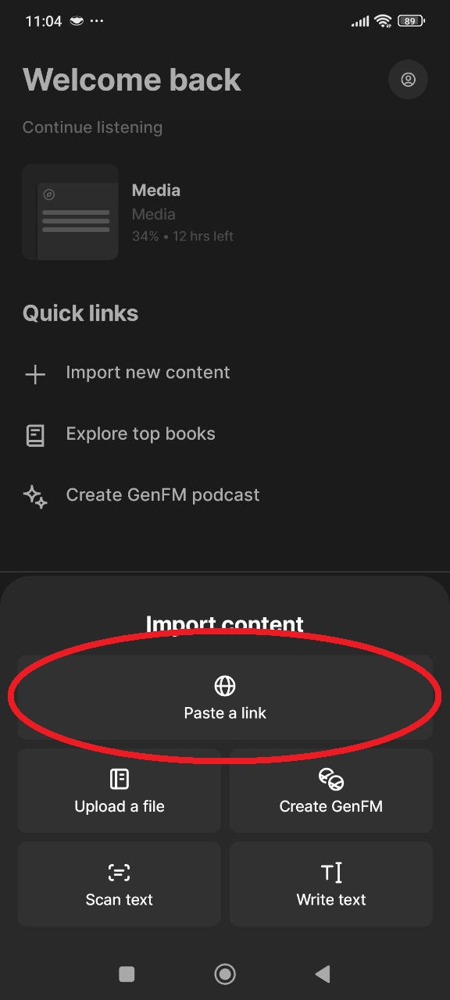
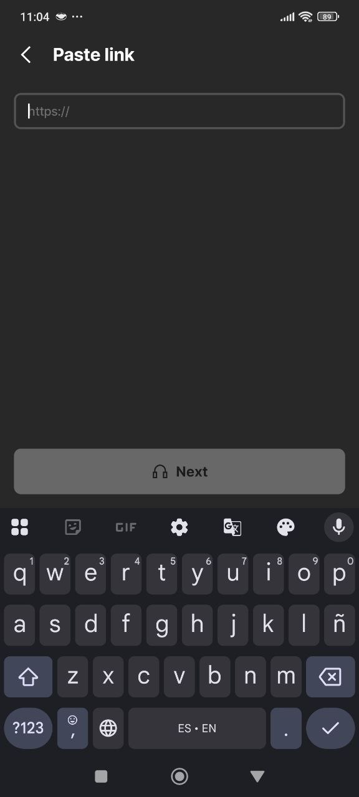
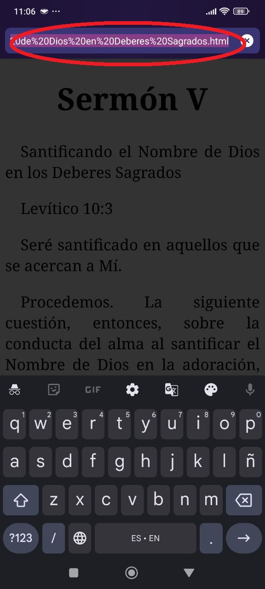
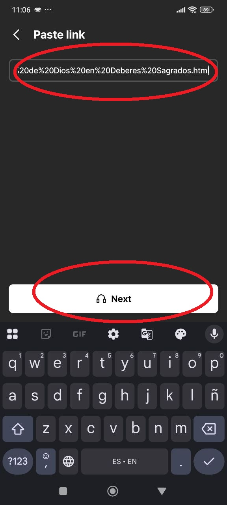
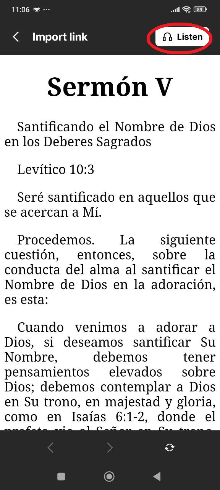
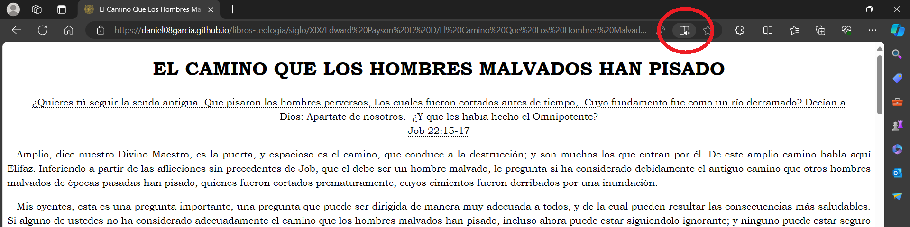
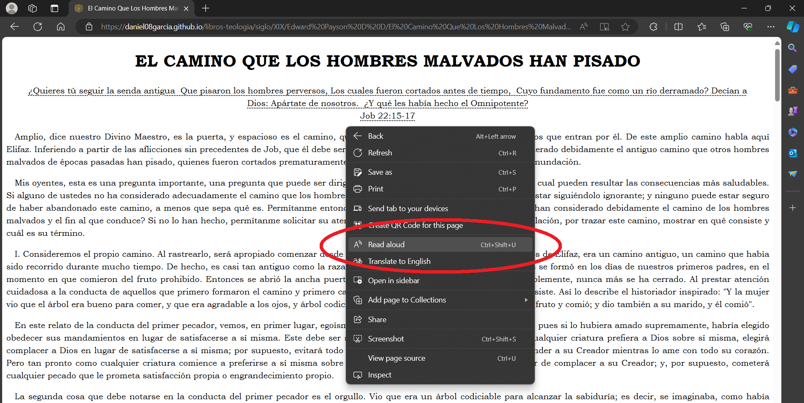
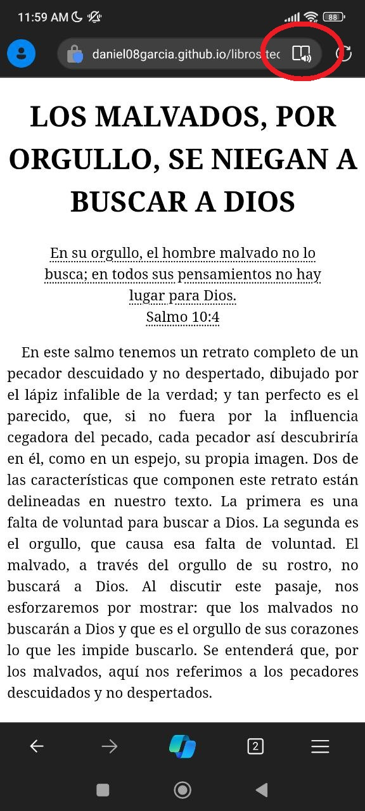
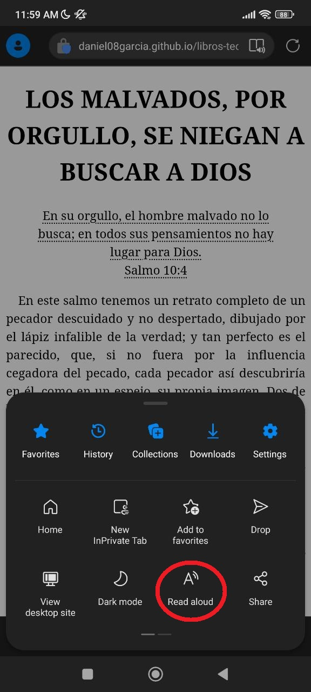

# Bienvenido a libros-teologia

¡Gracias por mostrar interés en nuestro proyecto! Este repositorio contiene una colección de textos teológicos traducidos al español, provenientes de siglos pasados. Nuestro objetivo es facilitar el acceso a estos libros y sermones que son de dominio público, permitiendo que más personas puedan beneficiarse de ellos en su propio idioma.

## Índice de Artículos

Puedes ver el índice completo de todos los artículos subidos hasta ahora [aquí](https://daniel08garcia.github.io/libros-teologia/).

## Leyendo el Artículo en Formato PDF

Para una experiencia de lectura más cómoda y portátil, te recomendamos imprimir el artículo en formato PDF. Para hacerlo, sigue estos pasos:

1. Abre el archivo HTML del artículo que deseas leer.
2. Utiliza la función de impresión del navegador web. Puedes acceder a esta función desde el menú del navegador o presionando `Ctrl + P` en Windows o `Cmd + P` en macOS.
3. Selecciona la impresora PDF como tu dispositivo de impresión.
4. Ajusta las configuraciones de impresión según tus preferencias, como el tamaño de la página, la orientación y los márgenes.
5. Haz clic en "Imprimir" para generar el archivo PDF.
6. Una vez que se complete la impresión, tendrás un archivo PDF listo para leer en tu dispositivo o para compartir con otros.

## Escuchando el Documento

Puedes aprovechar la función "leer en voz alta" del navegador Microsoft Edge o alguna aplicación como ElevenReader para escuchar los documentos en tu computadora o teléfono móvil. Para ello sigue estos pasos:

### Desde la app de ElevenReader

- **Toca el gran botón “+”** que aparece en el centro de la barra inferior. Ahí comienzan todas las importaciones de contenido.



- En el panel **Import content**, elige **“Paste a link”**. Esta opción sirve para transformar en audio cualquier página web o artículo en línea.



- Se abrirá el campo de texto para la URL.



- En tu navegador u otra app, **copia** el enlace del artículo (selecciónalo y pulsa ‘Copiar’). Este paso solo ilustra de dónde sale la dirección URL.



- Una vez pegado el enlace, el botón **“Next”** se iluminará. Tócalo para que ElevenReader analice la página y extraiga el texto.



- Cuando el artículo cargue, toca **“Listen”** (arriba a la derecha) para que la app genere y reproduzca el audio al instante. ¡Listo!



#### Consejos rápidos después de pulsar **Listen**

1. **==Cambiar voz, idioma o velocidad==:** toca el icono de ondas (abajo) mientras escuchas.
2. **Lectura destacada:** cada palabra se resalta a medida que se pronuncia, útil para seguir el texto.
3. **Sin gastar créditos:** la app usa un servidor aparte; no descuenta caracteres de tu plan ElevenLabs.
4. **Sólo streaming interno:** por ahora no se puede descargar el audio; vuelve a la app para re-escucharlo.

> **¿Problemas?**
>
> - Si el botón “Next” no se activa, asegúrate de que pegaste una URL completa que empiece por **https\://**.
> - Si aparece “Cannot process document”, intenta con otra página o espera unos minutos, puede ser saturación del servicio.

### Desde una Computadora de Escritorio:

1. Abre el documento HTML que deseas escuchar en Microsoft Edge.
2. Haz clic derecho en cualquier parte del documento para abrir el menú contextual.
3. Selecciona la opción "Leer en voz alta" o utiliza el atajo de teclado `F9`.
4. El navegador comenzará a leer el documento en voz alta. Puedes pausar, reanudar o detener la lectura según sea necesario.





### Desde un Dispositivo Móvil:

1. Abre el documento HTML que deseas escuchar en Microsoft Edge en tu dispositivo móvil.
2. Toca y mantén presionado cualquier parte del texto para seleccionarlo.
3. En el menú emergente, busca y selecciona la opción "Leer en voz alta".
4. El navegador comenzará a leer el texto en voz alta. Puedes ajustar la velocidad de lectura y detener la reproducción según sea necesario.





## Sobre el Proyecto

Este proyecto se enfoca en la traducción de textos teológicos de siglos pasados al español. Creemos que al hacer accesibles estos textos en español, estamos proporcionando una oportunidad para que más personas puedan estudiar y aprender de la rica tradición teológica de la historia de la Iglesia.

## Estructura del Proyecto

Los archivos se organizan por siglo (en números romanos) y luego por el nombre del autor. Si un texto forma parte de una obra mayor (un libro, una colección de sermones o un volumen), se agregan carpetas para la obra:

```
siglo/
  [Siglo]/
    [Nombre del Autor]/
      [Título del texto].html
      [Nombre de la obra]/
        [Título del sermón].html
        [Volumen]/
          [Título del sermón].html
```

Ejemplos reales:

- `siglo/XV/Martín Lutero/Sobre la libertad cristiana.html`
- `siglo/XIX/William S Plumer/Piedad Vital/Observaciones Generales sobre la Experiencia Religiosa.html`
- `siglo/XVIII/Jonathan Edwards/The Works of Jonathan Edwards/Volumen 2/Pecadores En Las Manos De Un Dios Airado.html`

## Cómo Crear el Archivo HTML de un Sermón

### Por qué el formato es tan simple

El objetivo principal del proyecto es que cada texto se pueda **exportar fácilmente a PDF, EPUB o cualquier otro formato**, y que funcione bien con lectores en voz alta (Edge, ElevenReader, etc.). Por eso cada archivo es un HTML mínimo: solo títulos, párrafos y citas, sin estilos, tablas, listas, imágenes (excepto la portada) ni scripts. Mientras más simple sea el archivo, más herramientas lo podrán convertir sin perder nada. Ejemplos de esas herramientas son la impresión del navegador, [Calibre](https://calibre-ebook.com/) y [Pandoc](https://pandoc.org/).

### Paso 1: Elegir la carpeta y el nombre del archivo

- Coloca el archivo en la carpeta del siglo, autor y obra que le corresponda (ver la estructura de arriba).
- El nombre del archivo es el **título en español**, con extensión `.html`. Por ejemplo: `La Agonía De Cristo.html`.
- No uses los caracteres `\ / : * ? " < > |` en el nombre, porque no están permitidos en Windows. Si el título es muy largo, puedes acortarlo y terminarlo en `---`.
- Si un sermón original se predicó en varias partes, crea un archivo por parte y agrega `I`, `II`, `III` al final del nombre. Por ejemplo: `La Perpetuidad Y El Cambio Del Sabbath II.html`.

### Paso 2: Copiar la plantilla

Copia esta plantilla y reemplaza todo lo que está entre corchetes:

```html
<!doctype html>
<html lang="es">
  <head
    data-published-date="[Fecha de publicación original, AAAA-MM-DD]"
    data-author="[Nombre del autor]"
    data-sermon-id="[Número del sermón en números romanos: I, II, III...]"
    data-sermon-title="[Título en español]"
    data-sermon-title-original="[Título original en inglés u otro idioma]"
  >
    <meta charset="UTF-8" />
    <meta name="viewport" content="width=device-width, initial-scale=1.0" />
    <meta name="description" content="[Título en español]" />
    <title>[Título en español]</title>
    <link rel="icon" type="image/x-icon" href="[../]assets/favicon.ico" />
    <link rel="stylesheet" href="[../]css/style.css" />
  </head>
  <body>
    <!-- Cover Page Image -->
    
    <div style="break-after: page"></div>
    <h1>[Título en español]</h1>

    <blockquote>
      [Texto bíblico del sermón]<br />
      [Referencia, p. ej. Romanos 9:18]
    </blockquote>

    <p>[Primer párrafo del sermón.]</p>

    <p>[Segundo párrafo del sermón.]</p>
  </body>
</html>
```

### Paso 3: Llenar los datos del `<head>`

| Atributo                     | Para qué sirve                                                                                                                                               |
| ---------------------------- | ------------------------------------------------------------------------------------------------------------------------------------------------------------ |
| `data-sermon-id`             | **Obligatorio.** Número del sermón dentro de su carpeta, en números romanos. Define el orden en el índice; si falta, el archivo **no aparece** en el índice. |
| `data-sermon-title`          | Título en español (el mismo del `<title>` y del `<h1>`).                                                                                                     |
| `data-sermon-title-original` | Título en el idioma original, para poder ubicar la fuente.                                                                                                   |
| `data-author`                | Nombre del autor.                                                                                                                                            |
| `data-published-date`        | Fecha de publicación o predicación original, en formato `AAAA-MM-DD`.                                                                                        |

El `<title>` es importante: es el título que usan el navegador al imprimir a PDF y herramientas como Pandoc o Calibre al crear un EPUB.

### Paso 4: Ajustar las rutas relativas (`[../]`)

Las rutas a `assets/` y `css/` dependen de qué tan profundo esté el archivo. Escribe un `../` por cada carpeta que haya entre la raíz del proyecto y el archivo:

| Ubicación del archivo                                        | Prefijo           |
| ------------------------------------------------------------ | ----------------- |
| `siglo/XV/Martín Lutero/archivo.html`                        | `../../../`       |
| `siglo/XIX/William S Plumer/Piedad Vital/archivo.html`       | `../../../../`    |
| `siglo/XVIII/Jonathan Edwards/[Obra]/[Volumen]/archivo.html` | `../../../../../` |

Por ejemplo, con tres carpetas la hoja de estilos queda como `href="../../../css/style.css"`.

### Paso 5: Escribir el contenido

Usa **solo** estas etiquetas dentro de `<body>`, después de la portada:

| Etiqueta                 | Uso                                                                                                                 |
| ------------------------ | ------------------------------------------------------------------------------------------------------------------- |
| `<h1>`                   | Título del sermón (solo uno por archivo).                                                                           |
| `<h2>`, `<h3>`           | Divisiones internas, si el original las tiene (por ejemplo, partes o capítulos).                                    |
| `<p>`                    | Cada párrafo del texto. Los encabezados cortos del original, como `SECCIÓN I.` o `DOCTRINA.`, también van en `<p>`. |
| `<blockquote>`           | El texto bíblico al inicio del sermón, u otra cita larga.                                                           |
| `<q title="Referencia">` | Cita bíblica dentro de un párrafo. La referencia del `title` se muestra al imprimir.                                |
| `<br />`                 | Salto de línea dentro de un mismo bloque (por ejemplo, entre el versículo y su referencia).                         |
| `<b>`, `<i>`, `<u>`      | Resaltar texto, solo cuando el original lo hace.                                                                    |

Reglas para mantener el archivo exportable:

- **Un párrafo del original = un `<p>`.** No unas ni dividas párrafos.
- **Sin estilos en línea** (`style="..."`), sin clases propias, sin `<div>`, `<span>`, tablas, listas ni scripts. La única excepción es el `<div style="break-after: page"></div>` de la portada, que separa la portada del texto al imprimir.
- **Sin imágenes** aparte de la portada.
- Las **notas al pie** se dejan como texto plano: el número entre corchetes en el párrafo (`[25]`) y, si se incluye la nota, como un `<p>` al final del archivo que empiece con ese número.
- Las **numeraciones** del original (`1.`, `2.`, `I.`, `II.`, `§ 14.`) se escriben como texto al inicio del párrafo, no como listas HTML.
- Guarda el archivo con codificación **UTF-8**. Los acentos pueden escribirse directamente (`á`) o como entidades HTML (`&aacute;`); ambos funcionan.
- Las citas bíblicas se traducen con la versión **Reina-Valera 1960**.

### Paso 6: Actualizar el índice

El archivo `index.html` se genera automáticamente con todos los archivos que tengan `data-sermon-id`:

```bash
npm install          # solo la primera vez (instala jsdom)
node createToC.js    # regenera index.html
```

Opcionalmente, formatea los archivos con [Prettier](https://prettier.io/) para que los cambios sean fáciles de revisar:

```bash
npx prettier --write index.html "siglo/**/*.html"
```

### Lista de verificación antes de enviar

- [ ] El archivo está en la carpeta correcta y su nombre es el título en español.
- [ ] `data-sermon-id` tiene el número romano que sigue al último sermón de la carpeta.
- [ ] El título en español es el mismo en `data-sermon-title`, `<meta name="description">`, `<title>` y `<h1>`.
- [ ] Las rutas `../` a `assets/` y `css/` corresponden a la profundidad del archivo.
- [ ] Solo se usan las etiquetas permitidas y no hay estilos en línea.
- [ ] El archivo se ve bien al abrirlo en el navegador y al imprimirlo a PDF (`Ctrl + P`).
- [ ] Se regeneró `index.html` con `node createToC.js`.

### Exportar a otros formatos

- **PDF:** abre el archivo en el navegador e imprímelo como PDF (ver la sección [Leyendo el Artículo en Formato PDF](#leyendo-el-artículo-en-formato-pdf)). La portada solo aparece al imprimir.
- **EPUB, DOCX y otros:** con Pandoc, por ejemplo `pandoc "La Agonía De Cristo.html" -o "La Agonía De Cristo.epub"`. También puedes abrir el HTML en Calibre y convertirlo desde ahí.

## Contribuciones

¡Estamos abiertos a contribuciones! Si deseas agregar más textos, corregir errores o mejorar la estructura del proyecto, no dudes en enviar un pull request. Para agregar un texto nuevo, sigue la guía [Cómo Crear el Archivo HTML de un Sermón](#cómo-crear-el-archivo-html-de-un-sermón); el archivo `CONTRIBUTING.md` tiene más detalles sobre cómo contribuir.

## Contacto

Si tienes alguna pregunta o sugerencia, no dudes en abrir un issue o ponerte en contacto con el equipo de colaboradores.

¡Esperamos que disfrutes explorando estos valiosos textos teológicos en español!
